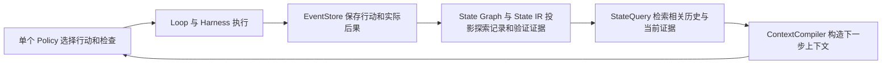

# Horizon-Weaver v1.3 探索历史与验证反馈

设计日期：2026-10-04；开发更新：2026-10-14。当前开发版本 1.3.0.dev19，补齐持续目标条件、候选事实、检查调用诊断和提交前证据复核。完整八项已结束，两个准确率提升目标未达标，不能将机制回归通过作为任务效果验收。基于 v1.2.0.dev2，目标是在现有组件中建立可积累的探索历史和客观的 verify，使单个 Policy 能利用后果调整方法，并依据当前证据结束任务。

v1.3 的主线是：行动留下经验，检查提供反馈，后续行动使用经验和反馈。解题策略、诊断方法和测试选择仍由 Agent 搜索。运行时维护事实、来源、有效范围和有限的执行约束。

## dev19 完整测试与验收状态

R21 同一源码、同一 Qwen3.5-9B Q4_K_M 配置，每项一次。测试前 302/302 回归通过（22 Docker、无跳过），六项真实模型协议探针通过；八项原生评分全部有效，没有评分恢复。相较 dev16/R18：TB 整项 **3/8 → 3/8**；正常提交且整项通过 **3/8 → 2/8**；检查 **20/30 → 11/30**。Agent 时间 **1744.9s → 1779.0s**；同状态同后果重复 **13 → 13**，运行时标记重复 **18 → 25**，零变化写入提议 **5 → 9**。

Hello 和 permissions 正常提交并通过。日志产物 3/3，但自检错误使用 argv 通配符，空输出转整数报错后模型重复计数至超时；没有提出 done，不能归因为提交动作被拒绝。异步保持 async 接口，4/6，两个 KeyboardInterrupt 取消测试仍失败；模型多步没有遵循调用修复反馈。JQ 九次读取同一大输入，产物缺失仍被提示，未形成有效下一步。SQLite 格式自检通过，但错误恢复值仍提交，暴露行为复核对证据充分性的判断不足。Regex 和 profiling 仍失败。

公开目标与客观结构事实已经实现，行为目标到实际谓词的覆盖关系仍不足。当前 Policy review 的来源、新鲜度和执行事实约束不能保证推论正确；与直接格式事实都显示 supported，尽管 authority 不同，仍容易夸大行为支持。下一轮应在现有 Verify/Context/Loop 内改善检查调用诊断、明确已测和未测范围、复用有效证据及大输入信息反馈；这些方向尚未实现或验证，不能宣称 v1.3 准确率优化完成。

结果与失败证据在 `runs/v1.3-goal-contract-r21-20261012/report.md`、`findings.md`、`comparison.json`。R19 中止轨迹和 R20 完整负面结果分别保存，不与 R21 拼分。代码、原任务、兼容层哈希、事件链、IR 和引用核对通过；本次容器、网络及模型服务已核对清理。单次结果不证明稳定因果。

## dev19 产物内容观测与公开格式条件

R20 的八项 Agent 均结束，日志计数正确却漏掉公开 CSV 表头（1/3）；JQ 两次读取大输入后，障碍提示将必需上下文推过 14k 预算而结束。四项原评分还遇到 HTTP 发行版镜像 502、curl/uv 缺失，原始无效评分保留，通过完全一致候选的原测试恢复补齐；不将无效评分当任务失败。R20 不作为最终验收结果。

公开格式是目标的一部分。GoalCondition 增加 csv_header 和 json_shape：仅绑定唯一明确输出文件，CSV 表头取公开结构声明，JSON 对象结构只约束已明示的根类型和键，不把示例值当固定结果。CSV 数据行正确不能替代表头；JSON 错误字符串数组不属于要求的数据对象。无法唯一确定目标文件时保持语义未知，避免猜测约束。

对需要内容判断的小型声明产物，Loop 在动作结束后进行受预算限制的只读观测，GoalObservation 随实际 Attempt 写入原 EventStore/State IR。只接纳成功且内容哈希与快照匹配的结果；不执行候选代码，也不生成额外模型请求。完整 read/write 已提供内容时复用已有观测；同一内容哈希跨无关动作保持有效。观察内容、已测谓词和 Policy 解释保持区分。

长公开目标的障碍提示采用简短接口说明，保留原目标、具体目标矛盾、最新工具返回与可检索历史，避免重复大文件读取触发必需上下文溢出。新增端到端检查覆盖漏表头、shell 生成产物、观测重放、错误 JSON 结构、示例值非固定 oracle 和重复大读取预算；六种模型协议探针包括上轮真实故障状态。最终 R21 须在全部回归与这些探针通过后，每项一次完整重新测试，不拼接 R19/R20。

## dev18 提交动作复核与长上下文协议

dev17 的 293 项回归和两项合成协议探针通过，但 R19 在真实长 JQ 上下文出现重复 500/错误 JSON 和未来证据引用，八项批次因此中止。已评分的 JQ 3/14 与未结束异步轨迹完整保留为诊断，不能与后续批次拼分。小夹具不能替代真实长度的接口检查。

目标条件、客观文件/接口事实与检查调用诊断继续保留。复核改为 Action.done.review，普通 read/write/command/verify 保持原有小协议，障碍认识也不再被强制附加整套目标便签。done 的 review 项包括 ref/status/satisfied_when/evidence_steps/evidence_check_ids/needed_information；运行时将其按既有来源规则验证后加入同次决策便签和 EventStore，原始 review 保存在 Action IR。复核文字不改变执行身份，也不成为外部验收。

最终八项前，须完成新源码全回归、合成提交/接口修复探针，以及完整 JQ 原文的初始/缺失交付物上下文模型协议检查。后两项仅生成动作并校验 schema，不执行 TB 容器、不运行评分，不计入 TB 成绩。最终 R20 使用新版本、每项一次重新完整测试；R19 明确排除。

## dev17 公开目标条件与证据复核

dev16 的不足是目标判断仍依赖可选便签，自检回执的投影没有建立目标评估闭环。R18 异步初稿为 async def，但自检传入协程对象且未 await，后续把产物改成同步接口；JQ 认识曾提出保存 cmd.sh，却未形成持续未完成条件。本次优化同时考察 TB 整项通过率、正常提交且整项通过率；提交数、回归通过数和耗时不能替代这两个准确率。

### 目标与状态的关系

在既有 TaskContract/State IR 中加入不可变 GoalCondition（id、公开 ref/quote、相关子条件 refs、类型、文件/符号等操作数）。适配器仅读取公开 instruction；通用识别器保留明确文件交付、Python 接口、明示文字内容和行为条件。没有任务名分支、隐藏测试读取或 TB 特制求解代码。输入路径、否定、示例和代码块不自动成为交付约束；不确定语义继续保留原文与 unknown。分组子条件不会丢弃其公开来源。识别器是有限语法解释器，不声称穷尽任意自然语言目标。

GoalCondition 随合同写入既有 EventStore 和 State IR，不随新的全局认识或便签消失。Verify 将它们与当前快照及已记录完整 read/write 内容关联：内容必须匹配当前文件哈希，不能从旧产物或截断输出虚构事实。文件存在、声明接口、文字内容支持分别限定范围；async 声明通过不代表取消行为正确。命令生成且尚未读取的代码保持未知，反馈明确请求观察。无额外验证 Agent、额外模型请求或隐式执行产物。

### 行为评估与信息反馈

同一个 Policy 使用 RequirementNote 的 status、satisfied_when、evidence_steps、evidence_check_ids、needed_information 复核行为条件。引用必须来自已经执行的观测或执行中的 done 检查；模型解释仍是主张，不提升为固定 oracle。Verify 区分明确候选矛盾、检查调用不符合公开接口、运行候选异常、当前证据不足。窄范围 AST 诊断识别直接调用 async 函数却不 await/调度，以及将已创建协程列表传给 Callable 接口；反馈修复测试调用、保留公开接口，不能将错误测试变成新的产品要求。检查异常保留原始异常和栈帧，结构化结果使用独立行标记和 base64 帧，退出警告不会再把真实异常覆写成 JSON 协议错误；多帧仍拒绝。

每步保留目标条件、当前事实和具体差距。上下文优先未满足的明确条件及检查调用问题，以 ref 指向完整原文；不再重复输出完整 GoalCondition 合同和多个大证据报告，给最新工具返回、探索后果和全局认识留下空间。

### 提交与客观性

TB 启用 require_goal_review。明确缺失交付物、已观察到的接口/内容矛盾阻止 done；未观察的具体接口/内容要求请求补充事实。行为条件需要提交前当前证据复核，在同一次 Policy 调用的 notes 中完成，普通动作保持简单。修改候选使依赖旧状态的复核失效；done 同步执行的新检查可以成为本次复核的证据。显式报告的语义未知仍是未知，提交不建立成功。未证实的错误自检预期仍不会自动成为永久公共要求；固定公开验收与人显式设置的 require_self_check 保留。

测试前须通过公开条件跨改写/重放、错误异步自检、遗漏命令交付、证据过期、同次 done 检查、协议退出警告、上下文预算和真实 Docker 回归，并用真实模型检查新解码 schema。之后固定源码和模型参数，在同一组八项原任务中各运行一次，不合并中断批次或额外尝试；保存独立原评分、产物和完整轨迹，再报告两个准确率及重复/耗时。

## dev16 提交权限与阶段标签保持一致

### 完整八项结果与当前验收状态

最终 dev16 源码 `c74876be99088b1a48e018be50e2728a8d40779a5657990867159ecbcc0fbbc5` 完整回归 **268/268，19 Docker，无跳过**。R18 八项各一次，8 项原生评分完整有效，无评分恢复。相较 dev14/R16，整项 **4/8 → 3/8**，检查 **25/30 → 20/30**；正常提交且整项通过 **0/8 → 3/8**。Agent 时间 **2358.5s → 1744.9s（-26.0%）**，模型调用 **139 → 122**，同状态同后果重复 **18 → 13**。四项 submitted、四项 timeout；提交改善不等于产物准确率提高。

Hello 2/2、权限 1/1、日志 3/3 均正常提交；JQ 正常提交但 13/14，遗漏 cmd.sh，实际使用 jq 仍不足以满足命令交付检查。异步从 5/6 降至 1/6，最终同步 run_tasks 违反公开 async 接口。正则、SQLite、profiling 仍 0/1、0/1、0/2。日志重复已知计数，SQLite 重复普通查询，profiling 在依赖成功后未建立速度/图像验证证据。

紧凑目标反馈 **122/122** 次送达，详细证据 **106/122** 次送达；模型 interpretation **0 次**、satisfied_when **1 次**、needed_information **1 次**。目标语义绑定和满足条件未可靠维护，许多状态只能未知。JQ 详细证据 0/15，task situation 总体 62/122，低于基线 120/139；不能断言因果影响，但保留为集成限制。

当前验收：事实/主张区分、持续反馈投影、有效范围和提交接口已实现并通过机制回归；完整语义目标评估、基础任务准确率提升与可靠策略采用尚未通过验收。R17 只作中止诊断，结果仅用 R18 完整八项与 R16 完整基线比较，不拼分。候选、事件及审计保留，本任务模型和容器/网络清理完成，Docker Desktop 保留。详见 `runs/v1.3-goal-feedback-r18-20261012/report.md`、findings.md。

dev15 完整回归通过 266/266（19 Docker，无跳过）后启动 R17。检查上下文接口时发现旧 SUBMISSION READINESS.phase 仍可能显示 self_test_required，而 submission.allowed=true。允许交回候选与显式要求自检必须一致；这个旧标签会把未核实预期重新表现成提交要求。R17 在完整八项完成前停止，只保留为诊断轨迹，不能与新批次拼分。

dev16 对 require_self_check=false 使用 goal_review 或 public_constraint_unsatisfied，检查工作的布尔值命名为 predicate_ready，测量通过阶段为 measured_predicates_passed。StateQuery 同样区分谓词工作与提交权限。显式 require_self_check=true 的合同继续显示并执行原自检要求。补充权限/阶段一致性的回归；重新完整验证后，在 `runs/v1.3-goal-feedback-r18-20261012/` 重新运行八项原任务，每项一次。最终比较使用 R16 完整基线与 R18 完整批次；R17 只作单列诊断。

## dev15 持续的目标、状态与差距反馈

本节替代此前将所有未解除自定义失败作为提交硬门槛的设计。Verify 在整个任务中回答：公开目标要求什么，当前实际观测是什么，已有证据支持什么，还差什么或不知道什么。检查执行器、历史回执和检查修订关系继续保留；检查列表不再代替任务目标。

### 目标、解释、事实与差距

原始公开目标与约束原样保留，G/C 只定位原文，不将每行文本自动变成义务，也不按引用数量报告完成百分比。已有 RequirementNote 增加可选 interpretation、satisfied_when、needed_information，连同 uncertainty、证据步骤进入已有 EventStore 与 State IR 的 notes_history。解释由同一个 Policy 在普通决策中逐步完善，属于可修订主张；简单行动不必先填写目标计划。同一来源可以描述多个不同的行为。

verification.goal_assessment 从合同、快照、行动、检查回执和目标便签生成只读投影，不调用工具、不调用额外模型。每项已表达的目标显示原文、解释、满足条件、证据来源/有效范围、当前状态、差距和待回答的问题。状态分为 supported、contradicted、unknown、disputed。supported 只支持已测谓词，不证明完整语义覆盖；未核实的 Policy 预期失败为 disputed，检查未完成或证据过期为 unknown。只有固定公开验收条件才拥有已核实的合同权威。模型标记 oracle=contract/public_input、填写来源或依据，都不会自动获得这个权威。

普通 read/command/write 产生的观测也进入当前事实视图，记录返回码、错误、是否执行、文件增量及来源步骤。命令成功不能证明行为正确；模型解释不会制造观测。原因未明确时，反馈提出能区分候选缺陷、预期错误和环境/调用问题的待确认信息，不推断固定修复动作。历史探索仍由 StateQuery 与 ContextCompiler 关联、检索和裁剪。

### 持续协作与测量有效性

每次普通行动后生成简短 GOAL UPDATE，下一次决策持续提供 GOAL / CURRENT STATE / GAPS。StateQuery 提供完整目标评估；ContextCompiler 将它与公开目标、最新实际回复及相关历史组合。超出预算时按完整结构行缩减详情，显示省略数量；不把截断 JSON 当作完整报告。没有新增 Reviewer、Planner 或反思模型，每轮仍只有一次 Policy 决策。新测量由 Policy 按剩余目标和信息需要选择，运行时不自动执行检查。

框架自己执行的 text_equals/json_equals 已知只依赖对应文件，因此无关文件变化或 shell 行动不会使比较过期。对应文件变化后，历史结果仍保留，当前证据转为未知。Python/process 检查未追踪完整读写依赖，继续保守绑定整个候选快照与执行环境 epoch，不声称已实现任意程序的精确依赖分析。文件比较复用保留原始来源步骤，不产生新执行或新信息进展。

测量报告保留实际/预期操作数，并对字符串记录解码后完整长度、真实换行数量、字面反斜杠+n数量。展示被截断时保留完整计数与截断标记，减少 JSON 展示层转义导致的误读。执行断言、无结论分类和不可改写回执的约束继续保留。

### 提交与验收分离

提交硬条件来自 TaskContract 中固定公开验收、声明的必要普通文件、已确定的执行结果，以及人显式启用的 require_self_check。固定合同检查不可被 Policy 替换。require_self_check=true 仍遵守当前通过比较和历史失败解除的显式运行规则；相关旧回归测试将原先隐式的要求写为显式合同。

当 require_self_check=false 时，自定义检查不因失败而获得永久提交权威。replaces/依据可以记录修订关系，但缺少这类元数据不会把正确候选永远卡住。done 表示交回候选；即使同次自检失败，失败回执仍原样保留，返回候选不升级为验收通过。非法定义/无效引用仍拒绝执行；结果未知仍由 Supervisor 中止，避免将未确定执行当成完成。

报告分别表示 submission.allowed、predicate_ready、completion_established 和外部验收状态。允许提交不代表已完成目标；未知覆盖保持未知，Policy 应依据全目标判断是否提交。TB 合同始终只提供隐藏评分身份，测试在 Agent 返回后运行，不将隐藏测试反馈混入 Agent 决策。

这项门槛变化本身可能改善正常提交数量，不能据此声称解题准确率提高。新的完整八项复测单列，对比 dev14/R16 的整项 4/8、检查 25/30、正常提交且整项通过 0/8、同状态同后果重复 18、Agent 时间 2358.5 秒。保持同模型/参数/40 步/300 秒、原任务及原测试，每项一次，不拼分。报告同时分析提前提交、错误自检、剩余真实目标缺项和反馈使用情况。当前实现与回归/实测结果将在本节追加。

## dev14 检查定义的入口与取回

### 同源码的完整八项复测

R15 两项定向复测之后，按用户要求用同一份 dev14 源码运行新的完整八项，各一次、同模型和预算，未修改实现。结果 **4/8、25/30**，与 dev12 的完整八项相同；**正常提交且整项通过 2/8 → 0/8**。六项 timeout，两项 no_progress；Agent 时间 **1784.1s → 2358.5s**，模型调用 **128 → 139**。同状态同后果重复 **30 → 18**，零变化写入 **22 → 6**，少重复没有转化成收尾和耗时收益。

四个简单任务产物全部通过原测试，但全部未正常提交。Hello World 和权限自检误把换行改成字面量反斜杠+n；权限还将修订写进工作区 JSON 文件，未改变 EventStore 定义。日志的最新比较通过，但缺少对旧错误预期的显式替代，后续反复复用；JQ 的重建自检参数错误被误诊为候选错误。异步仍 5/6，关键取消检查失败；正则误读目标，SQLite 恢复不完整，profiling 没有实际等价与性能测量。

七项有效原生评分，正则评分因依赖安装超过外部期限未执行，通过完整一致候选的原脚本/原测试补评分得到 0/1，无额外 Agent 尝试。所有源码、输入、初始快照、事件链、IR 和保存引用审计通过；八个候选完整保留，自有资源已清理，Docker Desktop 保持运行。同源码 248/248（19 Docker）回归按逐文件哈希核对后沿用，未重复执行。报告见 `runs/v1.3-smoke-r16-20261011/report.md`、findings.md。

这次没有触发 Python 语法入口错误，不能把结果变化归因于该项机制。61 条带证据引用的认识中有 21 条核心文字重复；真实引用和当前工作提示不保证解释正确或修订动作有效。检查表示、修订接口与目标验证仍需完善，整体准确率与完成效率目标未验收。R15 定向的 2/2、正常提交 1/2 和 R14 负面结果继续单列；执行顺序与单次采样不同，不从多轮挑选拼分。

### 入口设计与此前两项定向复测

dev13 的真实模型复测证明阶段提示可以被采用，但没有改善收尾。日志生成正确产物后被多项语法无效的 Python 检查卡住；JQ 在一次失败检查后持续生成/改写产物，没有重测，最终产物也退化。这些结果完整保留，不以降低通过标准或挑选较好轨迹代替修复。

新增检查的 Python 源码在 ModelPolicy 解析入口做语法解析和编译校验，不执行代码。语法无效时整次动作被拒绝，没有检查回执、保存定义或产物修改；反馈定位检查与行号，说明应修正检查代码。合法代码中的实际断言失败仍是候选反例；缺依赖、运行错误等仍由执行器报告无结论。语法校验不能证明检查相关、预期正确或目标覆盖完整。

不把入口校验加入不可变 CheckSpec/Action 的回放验证器：旧记录中的无效源码仍能解码和追溯。工作状态能识别旧定义的语法错误；即使候选变化，也提示纠正检查，不建议重复运行同一段坏代码。历史测量及其状态保持不变。

沿用 HistoryQuery，增加可选 check_id，与 steps 合用时返回该次回执的真实定义、定义哈希、结果和状态范围。使用保存 ID 重测也可取回实际定义，不依赖动作本身是否含完整代码。工作集为未解决的检查提供可执行的只读取回建议，无结论回执显示有界代码片段及完整性标记；旧检查谓词不再因同一动作已列在上下文中就直接省略。公开目标和最新文件读取仍优先保留，详细工作状态按预算缩减。

保持单个 Policy 和既有组件，不添加第二个审核 Agent、自动解题步骤或额外反思调用。修订预期仍要求明确依据、相关公开来源与当前通过的实际比较，历史失败不会被语法校验自动抹去。长目标导致预算紧张时先缩减工作状态详情，再缩短可重复的接口说明；历史取回提示有预留预算，完整公开目标和当前文件读取仍优先。

dev14 最终源码 `917790938c3c1d01853272b85839729fcb141ccaffb3298f5bd54a0f800319a1`，完整回归 **248/248，19 项真实 Docker，无跳过**。原始日志/JQ 各一次，两项有效原生评分 **2/2、17/17**，正常提交且整项通过 **1/2**。相较 dev12 同两项 **2/2、17/17、正常提交 0/2**，检查总分不变；Agent 时间 **474.0s → 331.8s**，模型调用 **46 → 28**，同状态同后果重复 **10 → 3**，零变化写入提议 **8 → 0**。前一版 dev13 的 **1/2、9/17、正常提交 0/2** 退化结果完整保留，不择优拼分，不组合为新八项成绩。

日志第 6 步用原日志重新计算预期并完成六个比较，第 7 步在 ready_to_submit 状态下选择 done，**3/3、71.9s**。JQ 候选 **14/14**，但四项 process 自检误用 shell 引号、字面命令替换及预期 stdout，重测两次仍未纠正，**no_progress、259.9s**。这仍是检查生成与诊断的瓶颈。Python 定义入口在本次真实轨迹未触发，不能把收益归因于该条规则；覆盖完整性与预期正确性仍未知，整体准确率优化仍未验收。

该次定向原生 harness 按估计耗时先 JQ 后日志，dev13 的顺序相反，dev12 来自完整八项批次。批次、顺序和单次采样的差异限制因果解释。源码、输入、初始快照、事件链、IR 和保存引用已审计，候选保留，服务/容器/网络已清理，Docker Desktop 保持运行。完整回归与独立复测见 `runs/v1.3-verify-r15-20261011/report.md`、findings.md；当时尚未重跑完整八项，后续完整结果单列在上方，不与该次两项混合。

## dev13 Verify 的当前工作状态

dev12 的日志产物已经与原自检预期一致，却仍沿用旧失败解释、反复写入；JQ 的 verify 把说明性占位文本当作预期 JSON，检查未执行。此次在现有验证模块及其消费者中修复这两类衔接问题，保持单个 Policy、每轮一次决策，不增加审核 Agent 或自动解题流程。

Verification 的执行回执保持不可改写；`verification_state` 从保存的定义、执行回执、当前快照及执行环境范围投影每项检查的工作状态：当前失败、待重测、检查无结论、比较不足、预期尚未正确修订、等待修订检查的测量、已替代或当前通过。结果保留 last_status 和来源步骤，另列 current、失效原因和实际文件差异。产物变化不能把旧失败当成当前反例，也不能把旧通过提升为当前证据；当前正确性仍待测量。

当已有检查的状态是待重测时，工作集给出引用真实保存 ID 的 `verify/check_ids` 建议；当前比较和提交门槛通过时给出 `done` 建议。它们是可执行的接口引用，动作仍由 Policy 选择。当前失败要求检查候选/预期依据，检查无结论要求修正检查或前置条件，避免把所有问题都描述为产物失败。已有显式修订关系跨文件修改保留为待测量关系，优先重测修订后的定义；旧反例仍须由当前通过的修订检查才能解除，固定合同 oracle 仍不可改。

ContextCompiler 以相同的结构化状态构造完成前的工作集。历史检查明确注明“最后测量”，提供工作状态与变化，不作为新执行结果。StateQuery 的全局认识视图显示验证阶段和下一测量建议，旧事件与源记录保持可追溯。FailureReasoner 区分检查定义被拒绝、检查无结论及真正的测量失败。

`json_equals.expected` 必须为具体有效 JSON；无效占位内容产生明确的检查定义错误，说明没有执行检查或工具，不能据此推断候选错误。ModelPolicy 保留原响应与用量，同时将错误反馈定位到检查操作数；完整目标下的大型或由输入计算出的结果可用已有 python_assertions 从原始输入计算预期并比较关键性质，无需展开整个预期答案。非法候选 JSON 仍产生实际比较失败，两种错误不会混淆。

这些状态不证明预期正确或覆盖完整目标，不自动忽略历史失败，也不将建议或认识更新计为进展。未知的进程/网络变化仍是现有限制；当前范围只绑定已捕获的文件状态与执行范围。

dev13 完整回归 **242/242，19 项真实 Docker，无跳过**。受测源码 `88e835ce946442c791220d12a4545f6ca6290f5618b6724073c2e5dc755a5c41`；相同参数下原始日志/JQ 各运行一次，原生有效评分 **1/2、9/17**（日志 3/3，JQ 6/14），相较 dev12 同两项 **2/2、17/17** 退化，正常提交且整项通过仍 **0/2**，均 timeout。时间 **474.0s → 608.0s**；相同后果重复 **10 → 5**，零变化写入提议 **8 → 0**。少重复未转化成正确率或正常完成收益。两项结果单独报告，不拼成新的八项成绩；没有评分恢复、额外 Agent 尝试或择优拼分。源码、原任务、兼容文件、初始快照、事件链、IR 和保存引用已审计，服务及本次容器/网络已清理，Docker Desktop 保持运行。完整结果见 `runs/v1.3-verify-r14-20261011/report.md`，逐项原因见 findings.md。

## dev12 目标、后果与验证依据

本轮依据用户的设计取舍：上下文帮助同一个 Policy 根据历史动作、实际后果和可修订认识选择下一步；Verify 从完整公开目标出发，关注关键验证点，以客观观测和可靠预期为标准。策略选择仍由 Policy 搜索，不增加独立反思 Agent、额外模型调用或任务专用解题流程。下列规则替代旧版本中“达到反例必须提供错误对照才能修订检查”的要求；旧版设计与实验记录保留供追溯。

### 在正常决策中更新认识

简单任务仍可以直接输出动作。上一行动失败、验证无结论、提交被阻塞或监测到重复时，下一次正常决策使用 notes.understanding + action，简短记录当前困境、观测带来的认识变化、下一方向和已执行证据步骤。结构化解码要求这个小便签；非结构化提供方遗漏或写坏便签时仍执行合法动作，不另开一个反思回合。认识仍是 Policy 主张，不能创造运行时进展、完成证据或自动清除反例。

重复提示询问“相关条件发生了什么变化，或这次预计取得什么新证据”；不禁止相同动作。修复后重测、环境恢复后重试都可能合理。StateQuery 提供事实，Policy 解释原因；未知原因保持未知，不由运行时补写因果结论。

既有 notes.requirements 跨步骤保留最后一次对每个公开 ref/精确原文的说明，关联当前检查和仍不确定的交付。无关便签不会抹掉旧要求。未关联当前检查的公开文本位置显示为待审阅来源，不把每行文本自动解释成一个语义义务；Policy 仍须核对完整目标中的产物、行为、约束及性能条件。公开目标始终原样交付；模型挑选的要求表不能代替合同。

### 验证结果与验证预期分离

当前状态同时显示实际比较是否完成、pass/fail/inconclusive、被引用的公开来源、预期依据与来源权威。Policy 标记 public_input/contract 不会自动升级成可信 oracle；只有运行时核对匹配的合同比较获得 oracle_validated。引用存在不证明检查覆盖了引用要求。

候选错误时修复并重跑原检查；检查预期错误时使用 replaces、与旧检查相关的 target_refs、公开目标/原始输入依据以及当前通过的实际比较。负对照是可选证据，不是修订的强制成本。固定合同 oracle 不可被 Policy 替换；换 ID 或随意改断言不会自动抹掉旧反例。常量断言不作为提交/修订所需的比较证据。Python 非常量谓词过滤只是保守预检，不能证明语义相关性、预期正确或任务覆盖完整。

所有检查及修订保留在事件链中。修订表示 Policy 对预期的纠正主张；允许提交候选仍不等于外部验收。执行型检查、文件状态和环境的新鲜度要求沿用；不把过期通过当作当前证据。检查代码没有执行断言时直接提示应修改 checks[].code，避免误改产物中的测试。

### 评测计划与度量

使用 r12 相同模型、量化、16k 上下文、8 项原任务，每项一次、40 步/300 秒、串行。保留任务/兼容文件、模型及代码指纹，运行期间不修改源码。对比整项准确率、检查通过数、正常提交且整项通过数、Agent 耗时、模型调用数、失败提交、认识更新与重复动作。

重复采用两套互补指标：运行时 progress.repeated；离线按相同行动执行签名与相同观测文件起始状态统计再次提议，并另计相同后果、重复失败及零变化写入。签名不受 reasoning 文本影响。文件状态相同不证明进程/网络条件相同，因此报告为可确认的动作重复，不自动等同无效重复。对 r12/r13 使用同一计算代码。单次开发冒烟只描述本次结果，不能证明稳定因果收益。

结果目录：`runs/v1.3-goal-r13-20261011/`。

### dev12 实现与完整八项结果

最终源码指纹 `54e872068b09d775c9f789a89e9d6fc808067a2295983d92467d4bdca561110b`。完整回归 **232/232，包含 18 项真实 Docker，无跳过**。实际模型探针发现修订元数据容易在长检查代码后遗漏；解码接口现将替换关系、引用与依据置于操作数字段之前，并在修订变体中共同要求填写。运行时语义仍独立校验。

8 项 Agent 各运行一次，2026-10-11T18:40:45+08:00 结束。完整有效评分 **4/8、25/30**，相较 r12 的 **3/8、25/30**，整项增加一项，检查总数不变。Hello 2/2、权限 1/1、日志 3/3、Regex 0/1、异步 5/6、JQ 14/14、SQLite 0/1、profiling 0/2。按原任务标签，easy **4/4**（其中仅 2 项正常提交）、medium **0/3**、hard **0/1**，基础任务可靠性目标仍未达到。

评分来源为 6 项有效原生评分、2 项相同候选的原测试补评分。SQLite、profiling 原评分因软件源 HTTP 502 未执行测试，原始 0/0 无效记录保留。两次自动审批超时后，用户明确允许恢复评分和清理服务；在隔离容器中只调整 Linux 软件源 HTTP 为 HTTPS，核对完整候选快照后执行未修改的原脚本和测试，两项均首次恢复即获得有效评分，分别于 20:09:39 和 20:11:59+08:00 完成。不存在额外 Agent 尝试或择优拼分。

8 项 Agent 总耗时 **1755.6s → 1784.1s（+1.6%）**，模型调用 **142 → 128**。同文件起始状态且相同后果的重复 **19 → 30**，零变化写入提议 **9 → 22**；正常提交且外部整项通过仍为 **2/8**。权限任务实际修正漏写换行的错误预期，正常完成，约 **301s → 79s**；日志产物正确，却因重复写入停滞，约 **61s → 206s**。profiling 的在线依赖安装也遭遇 SSL EOF，网络条件变化影响比较，不能据此作稳定因果结论。

认识视图交付 **116/128** 次，真实 Policy 记录 **52 条带执行证据引用的认识更新**；三个核心字段在空白归一后有 **29 条重复既有文字**。便签采用已经发生，但策略更新、完整验证与效率目标仍未通过任务验收。产物变化后沿用旧失败解释，以及完整读取和拒绝反馈交替，仍是当前上下文的具体缺口。

已核对源码/任务/兼容文件、初始状态、事件链、IR 往返、动态 schema 和保存引用。模型服务按路径与启动时间核对后停止，捕获进程已自行退出，本次所有测试/评分恢复容器与网络均已清理；Docker Desktop 保持运行。完整 [结果报告](../../runs/v1.3-goal-r13-20261011/report.md) 与 [逐项分析](../../runs/v1.3-goal-r13-20261011/findings.md) 保留原始轨迹和限制。此轮实现与评测完成，准确率、重复与效率的任务层优化仍未通过验收。

## dev11 上下文认识与探索链（历史设计与实测）

本轮按用户要求先修改上下文管理，验证门槛、工具语义和测试预算保持 dev10 配置。目标是让下一轮决策知道为什么尝试、实际产生什么后果、哪些问题仍未解决；没有增加 Planner、Reviewer 或独立总结模型。

`PolicyNotes.understanding` 是可选的全局认识，包含 approach、current_problem、interpretation、next_focus、evidence_steps 和 open_refs。Policy 在同一次动作决策中提出或修订它；简单任务可以省略。引用必须来自已经执行的观测及公共 G/C 要求。无效便签按条丢弃，合法动作与其他便签继续执行。便签保存在既有 ModelCallCompleted 与 notes_history 中；新一轮只提供 exploration 便签不会抹掉此前全局认识。最新认识携带来源状态、引用步骤、此后文件变化与未知的进程/网络新鲜度，始终是 Policy 主张，不能成为成功证据。

StateQuery 纯投影构建三部分：当前产物与测量检查的全局视图、最新可修订认识、相关探索链。探索链连接原动作理由/假设及预期观察、实际执行、文件增量、检查结果、运行时信息进展和后续引用它的解释。检查失败只表明指定判定失败，不自动判断候选错误或预期错误；命令成功与窄检查通过不自动推导需求覆盖。重复条件与相同后果合并显示匹配步骤，旧未解决检查优先保留。底层记录、原任务文本和完整收据保持可追溯。

ContextCompiler 在最新工具回复之后为任务认识保留有限空间，按完整 JSON 行收缩探索链，并披露省略数量；不把截断 JSON 当作完整认识交付。原任务、最新回复与输入预算保持优先。没有认识记录时仍交付实际后果和未知项，不能自动补写失败原因。现有只读 history 查询保留，可取回被省略的详细事实。

认识变化不会单独获得运行时进展或解除失败；它需要对应真实观测。新增机制回归验证保留、修订、证据关联、旧认识过期提示、事实/主张分离、重复合并和预算交付。本轮真实模型沿用 Qwen3.5-9B Q4_K_M，八项原任务每项一次、40 步/300 秒；结果保存到 `runs/v1.3-context-r12-20261008/`。当前设计仍不能保证 Policy 采用便签、正确推断失败原因或完整验证任务。

### dev11 完整八项结果（r12）

最终源码指纹 `0c8555d93871760226b387f7b07e00d1dc337fe555ce42a5e56ce01b8db61000`。新回归 **225/225，包含 18 Docker，无跳过**。首轮发现最新回复被摘要挤压及历史动作格式问题，修复后重跑整套，失败日志保留。原任务/兼容文件、初始状态、Python 源码/脚本/测试、事件链、IR 往返和动态 schema 均已审计。

八项原任务、每项一次、同一模型与 40 步/300 秒，全部获得有效原始评分，无补评分：**3/8、25/30**，easy 3/4、medium 0/3、hard 0/1。Hello 2/2、权限 1/1、日志 3/3、Regex 0/1、异步 5/6、JQ 13/14、SQLite 0/1、Profiling 1/2。只有 Hello 与日志正常提交并整项通过；权限正确产物因旧错误预期阻塞而超时。JQ 主数据通过但遗漏 cmd.sh；异步仍未取消超出上限的任务；Profiling 速度通过但图像哈希不符。

相较 dev10 的 3/8、15/30，本轮整项不变、检查分数增加，但 Agent 总时间 **1038.9s → 1755.6s（+69.0%）**，模型调用 **71 → 142**。不同源码下的单次开发运行不能证明稳定因果收益。实际认识/探索链交付 **134/142** 次，最新回复遗漏 0；**认识更新 0、探索意图 0、动作理由 6**。可选便签未被真实 Policy 采用，因此只完成信息组织与接口基础，主动维护全局认识的闭环仍未通过任务验收。模型接口探针成功不能代替实际采用。

详见 `runs/v1.3-context-r12-20261008/report.md`、`findings.md`、`context-metrics.json`。任务义务遗漏、错误检查修订、测量接口理解和策略重复仍需要解决；不把输入增加或检查变多解释为整体性能提升。

## 设计依据

v1.2.0.dev2 的完整开发冒烟为 3/8 任务通过、20/30 检查通过；131 项回归通过不等于任务质量提高。现有 EventStore 已记录行动和结果，State Graph 已连接前后文件状态，但上下文主要选择近期行动，重复失败汇总也主要针对相同命令和相同完整文件状态。

已有轨迹说明两处缺口：SQLite 在已知读取失败后重复普通查询；异步任务只验证导入，Profiling 在依赖安装超时后未重新通过检查即提交。前者需要让历史影响行动，后者需要区分检查执行与检查证明的内容。见 [v1.2 实测报告](../../runs/v1.2-decisions-20261004/report.md)。这些是本轮观察，不能由单次实验认定全部原因。

## 核心协作

verify 是可选择的行动，执行结果进入同一条循环。保持一个决策主体和一份共享事实状态；每轮最多一次 Policy 调用。无需额外调用模型生成反思、总结或审核意见。验证的反馈来自执行和比较。

## 探索历史的表示与存储

### 一条经历需要保存什么

增加 `ExplorationRecord`，作为已有 Attempt 与事件的投影；不另建一份可改写的事实账本。

| 数据 | 内容与来源 |
| --- | --- |
| 身份与来源 | run_id、step、相关事件序号及哈希；区分动作提出、实际执行和未执行 |
| 当时条件 | 前后状态指纹、输入或产物版本、已观测的执行环境；未捕获的进程和网络条件明确为未知 |
| 行为 | 完整动作引用、动作签名、实际等待上限和执行 ID |
| 后果 | 退出状态、输出引用、错误、文件变化、超时或结果未知；由 Harness 和快照产生 |
| 验证反馈 | CheckSpec 和 Receipt 引用；测试执行、断言结果、版本与来源分别记录 |
| 探索意图 | 可选的问题、方法标识、假设、预期观察，以及引用的历史证据；属于 Policy 主张 |
| 成本 | 模型 tokens、工具时间、总耗时；来自已有计费与执行记录 |

模型省略探索意图时，实际行动和后果仍完整入库。格式错误的说明字段不会阻断合法执行，也不会被补写成事实。简单任务无需先填写计划或假设。

同一方法的多个尝试可以关联成一组，并保留每次的条件和后果。模型可以声明“这次修正针对上次失败”或“放弃此前假设”；关联必须引用已有记录。运行时检查引用是否存在，语义结论仍标为 Policy 主张。某命令执行失败，并不自动证明模型对失败原因的解释正确。

### 存储的三个层次

1. **原始事实**继续存于 EventStore 的 SQLite 事件链。原响应、动作、结果、快照和来源不可覆写；重放只还原数据，不执行工具。
2. **探索记录**由 State Graph 和 State IR 生成。保留全部有效历史便签的修订与依据，避免只剩最新一条便签。索引按产物、动作、问题引用、检查和结果定位经历。
3. **当前工作集**由 StateQuery 和 ContextCompiler 选取。模型看到与当前问题相关的历史、当前失败、仍有效的检查及剩余不确定性。

第一阶段直接投影已有事件，不新增数据库服务。规模需要时可以增加可重建的本地查询索引，索引绑定 run_id、事件链尾哈希和投影版本；不匹配就重建。索引和 IR 导出不是事实权威，不能独立制造成功。

v1.3 默认积累同一任务运行内的探索，并在恢复运行时保留。不同 TB trial 的历史隔离，避免把先前评分或解法带入下一次试验。跨任务经验迁移、语义检索和长期记忆晋升留作后续设计。

### 如何让历史影响下一步

StateQuery 提供按问题引用、文件版本、动作签名、结果类型和检查 ID 的查询。ContextCompiler 在原始目标与当前事实之后优先提供：

- 当前尚未解决的检查失败或执行障碍，以及它们之后发生了哪些相关变化。
- 当前产物或问题上的历史尝试，包括较早的失败；不限定为最近几步。
- 相同方法的尝试次数、输入版本、实际结果和引用位置。
- 同一问题上已有的有效证据及仍未知的条件。

同一结果只展示一条事实摘要，加上次数和来源；原始输出仍可查。摘要按字段生成，不增加模型总结调用。上下文不足时保留原始目标、当前状态和关键失败，显示省略范围，不能把被裁剪的输出当作完整可见。

提供一个只读的 `history` 查询动作，由 Loop 转交 StateQuery，用于取得未进入当前工作集的探索记录。查询受相同总步数和上下文预算限制，不调用 Harness 执行历史命令；重复读取已完整可见的记录不计为新增证据。

## 降低重复与左右脑互博

### 重复需要按条件判断

| 情况 | v1.3 处理 |
| --- | --- |
| 同一版本的完整文件已在上下文中，又请求相同读取 | 返回已记录的内容及来源，不产生新的实际读取证据；内容被裁剪时允许补读 |
| 写入内容与当前文件完全相同 | 保留动作提议，反馈零内容改动，不把它计为修复 |
| 相同命令在相同已知条件下得到相同失败 | 合并展示尝试与后果，指出哪些条件未改变；任意 shell 命令仍允许执行 |
| 命令变了，但 Policy 将其关联为同一方法 | 展示方法的历史和证据；方法标签不作为自动禁止执行的依据 |
| 文件回到此前版本 | 展示此前结果；回退可以是合理修复，不能只因版本曾出现就禁止 |
| 依赖、输入、等待上限或已观测环境变化 | 单独记录新条件，允许重新试验 |
| 网络、进程条件未知，或上次执行结果未知 | 不声称“完全相同条件”；沿用执行 ID 查询和恢复机制，避免重放结果未知的副作用操作 |

动作签名分为执行签名和显示标签：执行签名包括命令、输入及等待配置，不受 reasoning 文本影响；方法标签只是模型提供的检索线索。不同 shell 写法是否等价，运行时通常不能可靠判定。

对 SQLite 类轨迹，下一步应能看到“此前普通查询在这个输入版本上报错，输入是否变化、随后取得了什么新观察”。系统提供这组证据，由 Policy 决定检查文件头、换工具或采用其他恢复方法。运行时不携带 SQLite 解题配方。

重复反馈不能保证模型一定改变策略。v1.3 的可检验承诺是保存、检索并交付相关经历，消除可确认的无效文件操作；是否减少无效探索必须通过真实模型实验测量。

### 使用证据处理相互矛盾的判断

不增加 Planner、Executor、Reviewer 之间的多轮讨论。单个 Policy 的判断保留来源和修订关系；后来得到相反证据时，更新该判断的有效范围，而不是在上下文中并排堆积多段相互争论的总结。

“安装完成”“功能正确”等主张，分别关联实际执行和检查结果。没有对应事实时保持未确认；命令超时不升级为安装成功，新的说法不能覆盖旧错误。成功的事实和对原因的解释分开显示。

每轮输出一个行动即可；问题与假设是可选元数据。一次 verify 可以检查多个条件，一次失败只产生一份执行反馈。复盘发生在下一次正常决策中，不创建额外的模型调用阶段。

## 提升 verify 强度

### 明确一次检查在比较什么

扩展现有 verify 为 `CheckSpec` 与 `VerificationReceipt`。CheckSpec 描述本次可执行检查，Receipt 保存实际发生的比较和结果。

| CheckSpec 内容 | 作用 |
| --- | --- |
| 问题与目标引用 | 引用公共目标或约束，说明要检查的行为；引用存在不等于覆盖语义正确 |
| 被测对象与输入 | 记录产物版本、检查代码、公开输入或生成样例的来源 |
| 判定条件 | 明确实际值与预期值的比较，或可失败的行为断言、关系检查 |
| 预期依据 | 区分合同给定、公开输入推导、Policy 自拟、外部验收；自拟期望不能升级为独立 oracle |
| 执行与依赖 | 执行命令、检查定义哈希、候选状态和已观测环境，绑定结果的有效范围 |
| 可选对照 | 已知错误样例、候选变体或关系输入，用于观察检查能否发现指定错误 |

契约给定的 text/json 比较由 Harness 执行真实读取与比较；普通命令式测试仍可运行，但未知脚本的退出 0 只证明该检查进程报告成功。运行时不能仅凭包含 `assert`、文件名叫 test，或模型填写“覆盖了需求”就授予更高可信度。

### 分开记录检查执行、断言结果和需求覆盖

Receipt 的结果至少区分：

- `pass`：已定义的检查实际执行并满足判定条件。
- `fail`：检查实际得到违背条件的结果；结构化检查保存反例或实际值与预期值。
- `inconclusive`：测试语法错误、依赖缺失、超时、结果未知或未能到达判定条件。

传统 shell 非零退出仍记录为执行失败；没有可信的断言结果时，不自动认定它提供了任务行为反例。`inconclusive` 同样不能满足完成所需的检查。

另外保留三项独立属性：是否测试了目标行为、预期依据是什么、检查是否仍适用于当前候选。不存在一个仅由退出码决定的“验证强度分数”。Policy 的覆盖主张与运行时已观察到的结果分开。

### 让测试能发现错误

检查选择遵循一个问题：如果实现存在当前怀疑的错误，这个测试会失败吗？Agent 可采用以下方法，运行时提供执行和记录支持：

| 方法 | 作用与边界 |
| --- | --- |
| 行为断言 | 运行实际产物并比较结果；能发现语法和导入检查无法发现的行为错误 |
| 边界或反例输入 | 针对当前不确定性选择输入，记录失败样例；不要求每个任务执行固定数量的测试 |
| 公开参考比较 | 若已有可信实现或公开预期，比较结果并绑定参考版本 |
| 关系检查 | 例如输入顺序变化后结果应保持某种关系；关系来自任务要求或明确的 Policy 假设 |
| 错误对照 | 对一个已知违背判定条件的样例或候选变体执行相同检查，确认能在指定断言上失败 |

错误对照的作用是证明检查对某种错误有区分力。对照仅因语法错误或缺少依赖而崩溃，不算成功发现目标缺陷。对照和参考样例由 Agent 根据公开需求选择，运行时不自动生成任务专用变异规则。

上述检查并非固定流水线。简单精确输出可以一次比较完成；异步行为需要运行异步场景；性能主张需要实际计时、结果一致性与明确的比较对象。测试强度随不确定性和成本调整。重复执行相同通过检查，不自动增加覆盖或可信度。

对当前失败的示例：异步检查应实际观察任务完成、并发上限和取消后的状态；公开参数格式需要比较参数数组的结构；依赖缺失时先解决执行条件再重跑原检查。这些示例用于解释设计与开发测试，不写成 Policy 的任务专项流程。

### 检查的执行与有效期

第一阶段沿用保守的候选工作区指纹，再加上检查定义、输入和已观测环境版本。任一相关条件变化，旧证据标为过期；更细的文件依赖复用留到有可靠依赖跟踪之后。测试修改或删除失败断言，不能通过换一个 command hash 清除旧失败。

检查在 Harness 管理的临时验证位置执行，测试生成的日志、缓存和临时样例与候选产物分开。对于需要变体的检查，使用独立副本，保持正常候选不变。执行有唯一 ID、时间上限及清理记录；结果未知沿用现有查询与取消，不重复执行副作用命令。

若执行仍可能修改实际候选，则执行前后核对状态；变更后记录过期或执行异常，不能把变更前检查结果授予变更后候选。临时目录、输入与输出路径遵守已有工作区边界。

### 完成条件如何使用验证结果

区分“提交候选”和“验证通过”。隐藏 TB 评分仍只在交还控制后发生，不进入在线决策。

v1.3 提议把当前 `require_self_check` 布尔开关逐步替换为显式验证策略：有公开可执行验收时按合同验收；外部验收任务使用行为自检策略。简单精确结果可以使用 Harness 的直接比较，不必先生成测试脚本。

行为自检策略下，正常完成提交至少需要一个当前有效、实际执行的行为检查，并且没有尚未处理的相关失败或未完成检查。自然语言目标下的完整覆盖仍未知；仅有一条通过检查不能宣称所有需求已满足。合同提供结构化条件时，按条件检查覆盖；原始目标的物理行号不自动变成独立验收条件。

相关失败保留为尚未解决的问题，跨文件修改和命令更名继续可见。它可由同一条件的当前版本检查通过而关闭；其他检查替代旧检查时，必须保存替代关系和依据，标为 Policy 的替代主张，不等同于修复已被证实。结构化合同中的必需条件不能由 Policy 删除。没有可靠问题映射时保守保留失败；无法继续时允许明确交付未完成候选。

`done` 可以引用已有检查，或附带一组可执行 CheckSpec，由 Loop 在同一完成请求中执行。失败后返回实际结果，下一轮继续使用同一个 Policy；不调用审查模型。执行性 CheckSpec 必须通过参数校验，说明性 notes 仍可独立忽略。已满足检查时不重复执行。

总预算耗尽或 Agent 明确不能继续时，返回 `incomplete` 与未解决问题，并允许外部系统评分该候选。这样运行不会为了凑一次通过检查无限循环，也不会把未完成包装成成功。行为自检通过后的状态仍是候选提交，外部验收通过才产生相应验收事实。

## 对应现有组件的修改

| 现有组件 | v1.3 职责 |
| --- | --- |
| Core / Policy / TerminalPolicy | 定义探索意图、CheckSpec 与结果类型；执行参数和说明字段分开；支持只读 history 与带检查的完成请求 |
| EventStore | 保存新增事实和元数据的来源；保持事务、事件链和权威边界 |
| State Graph / State IR | 投影探索记录、历史主张修订、检查与候选的关系，保留未解决失败和有效期 |
| StateQuery | 检索相关经历、分组重复、查找失败后的条件变化、查询当前可用证据 |
| ContextCompiler | 提供探索工作集与证据状态；去除重复总结，不额外调用模型 |
| ProgressMonitor / TransitionGuard | 区分已确认冗余、可能重复和合理重试；文件改动与新增验证证据分别计量 |
| Verification / Harness | 执行判定条件与可选对照，记录反例、执行异常和环境；隔离测试临时产物 |
| Loop / Supervisor / Evaluator | 按验证策略处理完成请求与未完成交付；保持独立验收和总预算 |

增加数据表示与工具能力，不增加业务模块或额外 Agent。State IR 导出版本为 1.3；旧 1.1/1.2 导出可读取，旧字段缺失时标为未记录，不推断新的覆盖或成功。事件信封版本与 IR 版本分开处理。旧账本仍可离线分析，运行恢复需要显式的版本兼容检查，不能用新策略静默续跑旧实验。

## 实施顺序

1. **探索记录与检索。** 从 Attempt 和历史决策投影记录，保留主张修订；实现工作集选择与只读查询，验证恢复后历史一致。
2. **结构化验证。** 扩展 CheckSpec / Receipt，支持直接比较、命令式检查、异常分类与临时验证位置；可选对照只在 Agent 请求时执行。
3. **接入完成条件。** 保留未解决检查，把当前有效证据用于完成请求；提供一次请求内的检查及明确的未完成交付。
4. **分别测量机制与任务效果。** 先验证事实正确，再测是否减少重复和提高准确率；不把新增字段数量或自检通过率作为任务收益。

## dev7：把已有事实送回决策，把检查定义留在状态中

dev6 的失败轨迹揭示两个协作缺口：完整验证状态与接口说明可能挤掉最新工具结果；模型修复候选时还要重新生成长检查代码，容易改变判定条件或重复出错。权限任务还说明，实际执行了断言并不意味着调用方式符合公开要求。继续在现有模块中处理这些问题。

| 组件 | 本轮修改与边界 |
| --- | --- |
| ContextCompiler | 必须保留原始合同；压缩验证状态为索引，先为最新工具后果分配预算，再交付未解决检查、当前文件、近期事实与较早历史。长回执先提取失败判定及调用事实，再按字节预算裁剪；被裁剪的文件内容不能登记为完整观察。接口说明合并，移除重复账本序列化。 |
| Core / Policy / Loop | `verify` 和 `done` 支持 `check_ids:[id]`，引用本轮账本里最新的已执行 CheckSpec。ModelCallCompleted 保留引用请求，ActionProposed/ActionExecuted 保留解析出的完整检查；未知 ID 不执行。对候选的修复仍由 Policy 决定。 |
| Verification / Harness | 增加通用 `process` CheckSpec：argv、stdin、预期退出码及可选 stdout/stderr，直接执行参数数组并比较真实结果。记录实际调用信息；Python 单项比较记录左右值，保持一次求值与惰性错误消息。直接调用失败是针对该调用条件的反例，运行时不从自然语言自动推导目标调用方式。 |
| Verification / ProgressMonitor | 同定义、同候选、同环境下的运行时 text/json 比较可复用已测通过或失败结果，保留原来源步数；复用不创造检查回执、不计新增进展。任意 Python、进程、shell 检查继续执行，进程/网络状态未知时不能声称结果可缓存。 |
| EventStore / State IR | 沿用事件事实与 1.3 投影；新能力仍进入既有事件。旧检查没有 process 参数时接受其原定义哈希，离线读取不覆写旧账本；新增 process 参数不能借兼容路径绕过哈希校验。恢复执行仍需要原 manifest/source 一致。 |

例子：Agent 首次提出检查 `id=cli` 并执行；修改候选后可用 `{"kind":"verify","check_ids":["cli"]}` 运行原检查。若已经满足提交条件，直接 `done`；也可第一次在 `done.checks` 中执行检查并提交，减少额外决策。失败检查的保留、显式替换与错误对照要求沿用 v1.3，不通过放松失败门槛消除超时。

`process` 可以检查任意公开要求的程序调用，不携带 TB 解法。通过一种调用方式只能证明该次调用满足定义；模型选择错误的包装调用、弱预期或不相关检查时，完整需求覆盖仍未知。检查强度需用公开错误候选和独立评分检验。

真实协议探针发现模型将新 process 参数改写为旧 command。解码结构将 CheckSpec.kind 放在参数之前，使检查分支先确定；argv 至少一个元素仍由语法与运行时共同检查。此修复不添加模型讨论阶段。协议探针按版本分别保留，类型可生成与真实任务采用是两个验收层次。

验证顺序：比较求值语义与回执、原检查引用与版本变化、同条件结果复用、长合同上下文、旧账本往返；真实 Docker 中验证不可执行文件的直接调用会失败、改变权限后通过；同模型与原 40 步 / 300 秒预算运行八项 TB。新试验单独保存在 `runs/v1.3-exploration-r7-20261007/`，不合并旧版本最高分。

## dev8：历史事实与新行动的接口边界

dev7 完整机制回归为 **192/192，18 项真实 Docker，无跳过**，但 TB 开发冒烟在四项已评分后中断：hello-world 与 fix-permissions 通过，regex-log 超时失败，cprofiling-python 遇到模型服务 HTTP 500。服务日志包含模型输出的 `execution_signature` 字段，和上下文中历史行动的 JSON 外形相同。该格式可能诱导模型把已记录事实复制成待执行动作，是本轮实现需要修复的接口问题。部分结果与 log-summary 的未评分轨迹保存在 `runs/v1.3-exploration-r7-20261007/`，不能当作完整八项分数，也不和重测择优合并。

ContextCompiler 将历史行动改为逐字段事实，明确标识已经执行；历史查询中的字段使用 `observed_action`，避免历史账本仿照 Policy 的 `action` 信封。这只改变事实交付，不重写原始事件。最新符号链接读取若内容无法和文件哈希确认，仍交付真实工具回复，但不能登记为可复用的完整当前观察。

Gateway 把 HTTP 408、429 和 5xx 归为临时模型失败，Loop 在既有决策步数、tokens、时间及无进展预算内将失败反馈给单个 Policy。失败调用不执行工具，不创建虚假 Attempt，不另设无限重试。400 等非临时错误仍终止。临时错误的保守用量计量和原始错误继续进入事件。

dev8 单独重跑机制回归、真实模型协议探针和完整八项 TB，使用原模型与 40 步 / 300 秒预算，结果保存到 `runs/v1.3-exploration-r8-20261007/`。旧失败是发现修复点的开发证据；本轮八项仍是一次完整开发冒烟，不能证明稳定收益。

## dev8 完整八项与 dev9 接口衔接

dev8 完整回归 **196/196，18 项真实 Docker，无跳过**。同一模型、原始预算的完整八项为 **2/8、18/30 检查**，Agent 总时间 **1713.0s**：easy 2/4、medium 0/3、hard 0/1。Hello World 与权限任务通过；JQ 达到 13/14，但整项仍失败。完整结果在 `runs/v1.3-exploration-r8-20261007/`，不和 dev7 中断结果合并。

128 次模型调用中有 5 次协议错误、11 次模型超时、2 次临时服务错误。最新工具回复遗漏为 0，但保存检查引用的 4 次请求全部指向尚未定义的外部评分器 ID，实际执行为 0；错误对照和显式历史查询均为 0。不能把接口请求计为采用，也不能把机制通过计为准确率收益。历史呈现修改没有消除服务解析错误，重试只在原预算内继续运行。

dev9 处理两个实际协作问题，保持既有模块和单个 Policy：

1. **Policy / CompositionRoot：统一文件命名空间。** IR 和 terminal 前端共享路径转换，工作区来源于 Harness.describe。工作区内绝对路径及相对别名转换为同一相对路径后，仍经过原 State IR 和 Harness 校验；工作区外、前缀相似目录与 `..` 越界拒绝。检查文件、错误对照路径与 history 查询使用同一转换；不同写入键归一化为相同控制路径时拒绝，防止静默覆盖。程序 argv、命令和 Python 代码保持原调用含义。原始响应继续入账，裸 IR 与领域类型仍要求相对路径。
2. **ContextCompiler：区分可调用检查与外部评分器。** 外部评分器内部标识保留在合同、事件与 IR 中，从 Policy 合同投影移除；原始公开目标、约束和公开 inline 验收条件保留。已记录的 CheckSpec 提供有预算上限的 ID / kind / 来源步数目录，即使旧通过证据过期仍可重新执行定义。目录只表示可调用定义，证据有效性单独显示；定义使用同名外部 ID 时也不会被禁止，仍依据实际记录决定是否可调用。

离线重放 4 个实际路径错误响应，3 个经转换后成为合法动作；另 1 个仍因 JSON 预期值是占位符而拒绝，且原响应还包含重复检查 ID。路径可转换不等于整个请求有效；不删除其他字段约束，不替模型补预期答案。其谓词是否正确、候选是否通过仍需实际验证。Profiling 的四次未知 ID 请求不能自动生成检查定义。dev9 先做路径边界、组件组合与目录回归，再离线重放实际协议响应，最后单独复测 log-summary 与 cprofiling-python。定向复测是另一版本的两项结果，不拼成新的八项分数。

## dev9 结果与 dev10 状态引用

dev9 回归 **210/210，18 项真实 Docker，无跳过**。两项定向真实模型复测为 **1/2、4/5 检查**：log-summary 3/3，11 步、102.7s，实际走通失败比较、修改、重新比较和提交；cprofiling-python 1/2，301.2s 超时，未产生结构化验证收据，并两次引用不存在的 `saved_id_1`。两项合计 34 次模型调用、0 协议错误、2 次模型超时、0 临时服务错误。结果独立保存在 `runs/v1.3-exploration-r9-20261007/`。

dev10 将检查引用作为 State IR 的引用关系绑定，而非任意文本：

- ContextCompiler 从已记录 VerificationReceipt 的定义提取 `DecisionInput.known_check_ids`，包含失败及证据已过期的定义，不包含外部评分器 ID 或未执行的提案。
- ModelGateway 每次生成 schema：无保存定义时移除引用分支；有定义时 `check_ids` 的元素只能来自该集合。新 `checks`、command、read、write 等原能力继续可用。
- Loop 记录同一动态 schema 的哈希，继续在执行前解析并验证引用。无 schema/脚本 Policy 的错误引用仍不能执行，旧 DecisionInput 的缺省值为 None，保留原泛用 schema 接口兼容性。
- 这只把运行时已有的引用约束前移到解码接口，不强制计划、测试顺序、检查强度或解题策略，不新增 Agent。

六项新增回归覆盖空集合、枚举所有分支、旧请求、legacy、外部 ID 隔离和完整失败修复重验；已有目录回归确认旧定义即使证据失效仍可引用。动态 schema 改变需重新运行真实解码探针；随后只复测 profiling，作为独立单项开发诊断，不构成新八项分数。

dev10 实测完成于 2026-10-07T21:27:27+08:00：**216/216 回归，18 项真实 Docker，无跳过；两个真实模型动态解码探针通过**。首次 Docker 回归漏传缓存镜像参数，18 项启动失败；保留失败日志，指定缓存镜像后完整重跑通过。源码指纹 `3d34aaf41b6d4f82e7e270d42e666070a065998e1d7de5aff6375cc3229be3c9`。事件链、IR 往返、原任务/兼容文件未变、初始状态与 dev8/dev9 一致、所有动态 schema 哈希审计通过。

profiling 本次 **0/2**，15 步、218.2s，以 no_progress 结束；低于 dev9 单次的 1/2。依赖探测失败、安装超时后，Policy 持续重写 fast.py，没有形成有效验证。八次同内容写入被拒绝，两次状态循环被识别；记录与保护已生效，Policy 仍未据后果改变策略。0 协议错误、0 模型超时、0 HTTP 临时错误、0 最新回复遗漏；0 保存定义引用请求，0 结构化收据。未知 ID 为零同时伴随零引用，不能当作真实检查复用收益；更早停止也不等于更高效完成。

本轮验证的是引用接口一致性，未实现任务准确率收益。剩余缺口在失败后的策略转换与有效行为谓词选择，不能用继续堆模块掩盖。结果与负面轨迹独立保存于 `runs/v1.3-exploration-r10-20261007/`，不与 dev8 八项或 dev9 两项合并。简单/中等任务目标仍待验收。

## dev10 完整八项复测（r11）

2026-10-07T23:31:13+08:00 完成，源码仍为 dev10 的 `3d34aaf41b6d4f82e7e270d42e666070a065998e1d7de5aff6375cc3229be3c9`，未在测试中修改。源码/测试/脚本逐文件一致，复用同源码 216/216 回归与两个解码探针。原模型配置、40 步 / 300 秒，每项一次模型尝试。

有效评分 **3/8、15/30**，Agent 总时间 **1038.9s**；easy 3/4、medium 0/3、hard 0/1。Hello World 2/2、权限 1/1、日志 3/3、Regex 0/1、异步 5/6、JQ 4/14、SQLite 0/1、Profiling 0/2。日志产物正确，但旧错误预期未正式替换，done 被阻塞，最终 no_progress；正常提交且外部整项通过的只有 Hello World 和权限。

JQ 自检仅确认 jq 对空输入返回零，以及两个空输出重放相同，遗漏非空 JSON 与数据需求；异步自检遗漏超并发取消场景。Profiling 实际执行三项 process 检查，却使用了错误 argv 和把正则当精确 stdout 的预期。共 11 份行为检查、6 次 process、8 次文件比较复用；0 次 controls、0 次显式历史查询/保存定义引用，最新工具回复遗漏 0。接口可用与 Policy 选出足够强的检查仍是不同验收条件。

SQLite、JQ 原生评分遇到依赖安装错误，保留 parse_error；通过完整 SHA-256/权限/快照核验恢复原候选，只补跑原始测试，未增加模型尝试。最终六项原生评分、两项同候选补评分，原始 results.json 未改。其他原文件、事件链、IR 往返与动态引用审计通过。

相对 dev8 的 2/8、18/30，整项增加而独立检查减少，不能宣称稳定准确率提升。完整结果和逐项原因保存在 `runs/v1.3-exploration-r11-20261007/`，不与先前定向复测择优拼分。简单/中等任务目标仍未达到。

## 验证与实验

机制测试覆盖事件往返、索引重建、历史便签修订、跨版本证据、检查变更不能抹掉旧失败、实际反例与执行异常的区分、错误对照到达指定断言，以及验证副本不会改变候选。恢复和查询不得重放工具；网络或进程未知不得被文件哈希冒充为相同条件。相关执行与隔离路径需要真实 Docker 测试。

开发样例使用公开要求构造正确与错误候选，测量自检能否接受正确候选、拒绝指定缺陷，并统计检查成本。公开样例与故障注入结果只能证明对这些缺陷的区分力，不证明任意任务的测试覆盖。隐藏评分、预期答案和评分后诊断不进入在线探索历史。

真实模型采用四组对照：共享 v1.3 实现的 legacy 控制、仅探索历史、仅增强 verify、两者共同启用。固定模型、任务初始状态、预算、生成参数和提示模板；接口能力导致的必要模板差异单独记录。机制配置开关独立，模型输出上限和提示风格不同时调优。每组先做八项单次开发冒烟，再对完整同批任务做重复试验；至少三次仅作为观察波动的起点，不足以宣称统计显著。

同时报告整项通过率、独立检查通过率、尚未解决失败后的提交、同一已知条件的重复尝试、回退次数、模型调用数、tokens 和 Agent 时间。文件循环和 shell 重试是否无效不能仅靠计数认定；抽查失败轨迹并保留未知条件。效率比较优先使用两组都正确完成的任务，所有失败与耗时仍完整报告。

设计验收分两层：机制层要求来源、查询、检查分类与有效期正确；任务层要求增强检查能发现公开开发样例中的指定缺陷，真实模型准确率与重复行为的变化由独立评分和完整轨迹确认。若只有记录更多、自检更多而任务效果未改善，准确率优化仍未通过验收。

v1.3 不预先承诺 TB 得分或消除全部重复。待验证的核心假设是：可靠地积累和检索探索后果，配合能发现当前错误的检查，可以让单个 Agent 在同样预算内更有效地搜索。

## dev1 实施记录

现有组件已实现探索记录、历史便签修订、只读 history 查询、按预算逐条交付历史、结构化比较、实际 Python 断言计数、三类结果、错误候选对照、完成请求附带检查和明确未完成交付。State IR 为 1.3，旧账本保持离线可读。没有新增业务模块、总结模型或审核 Agent。

最终机制回归 **160/160 通过，包含 16 项真实 Docker，无跳过**。首轮新增符号链接测试用 Windows 主机读取 Linux 链接导致失败，已改为容器内检查和清理，原始失败日志保留。其他开发检查发现并修复了过大的历史摘要被整段省略、Windows 当前目录阻止验证副本清理，以及长检查超过 Windows shell 长度限制的问题。

证据有效期另绑定已执行 shell 操作的序号，保守处理工作区外依赖变化。修改测试需区分修复候选和修正错误测试：新的 ID 或较弱断言不能自动清除已发现反例；显式替换记录依据与公共目标关系，替换已到达的失败断言还需要新检查拒绝错误对照。替换保留为 Policy 主张，不能替代合同验收。测试崩溃可以由真正执行的相关行为检查显式替换，避免强迫 Agent 重复损坏脚本。

TB 两项机制有独立开关，默认均启用。兼容旧 JSON 合同时缺省使用 legacy 策略。对照组使用同一 v1.3 代码中的 legacy 模式，包含共享的协议与投影修改，因此它不是旧 v1.2 二进制的完全复刻。输出与时间预算沿用 dev2，必要的接口描述随能力启用，实验披露这一差异。完整回归日志为 `runs/v1.3-exploration-20261004/regression-final.log`。

## dev2 协议整合

dev1 两项真实模型预检为 1/2；hello-world 虽被外部评分通过，运行时却因 terminal 协议与结构化 checks 混用而停滞，不能作为接口成功。原始预检和 dev1 源码保留。dev2 默认改为 State IR 动作和 JSON Schema 解码，按任务开关裁剪能力，将 command 验证与 checks 验证定义为互斥变体；检查也按类型限定操作数字段。实际请求的 schema 哈希和能力参数进入事件。运行时仍独立校验，关闭的结构化检查不能经脚本绕过。四组试验统一使用该接口，旧 v1.2 terminal 结果只能作为历史参照。

## dev3 解码兼容修复

dev2 请求虽然声明 JSON Schema，本地 llama.cpp 的嵌套引用未形成预期字段约束；展开引用时，CheckSpec.code 的 32000 字符上限又超过其语法重复上限 2000。独立协议探针保留了原始、仅展开、仅移除解码长度和共同修正的结果。共同修正后非法嵌套字段被约束，32000 字符限制仍由运行时校验。历史上下文不再渲染无关默认字段。dev2 两项预检为 1/2、7/8 检查；首组试验因协议问题中止，完整与中断轨迹单列，不混入 dev3 的四组试验。

四组真实网关协议探针进一步发现 notes 的 anyOf 与同层 properties 被本地转换器分开处理，说明字段可逃逸对象约束。dev4 将每个分支写成完整对象条件；不改变 notes 的运行时语义或权限。dev3 机制回归为 163/163，其中 16 项真实 Docker。dev3 没有运行 TB 得分试验，源码归档保留，dev4 将重新校验并独立运行。

## dev5 实际判定条件

dev4 权限轨迹中的检查已实际比较返回码和输出，并在不符时退出 1，但执行器只计数 assert，将有效检查误判为无验证并重复执行。dev5 记录实际求值且以非零退出或 AssertionError 为失败终点的条件；保留原始分支诊断，捕获异常后的失败条件仍不能被吞掉。未到达的条件、零退出、依赖错误仍不能产生通过。assertions 字段为兼容字段，计数实际 assert 与等价失败 guard，输出注明来源。新测试覆盖正确候选、错误副本、吞掉退出、不可达分支和执行异常，并在真实 Docker 验证子进程检查。dev4 已评分和中断轨迹独立保留，不与 dev5 混合。

dev5 的完整机制回归为 **168/168 通过，17 项真实 Docker，无跳过**。真实模型独立预检为 **2/2 任务、3/3 外部检查**，没有动作解析错误或模型超时。权限任务经历行为检查失败、修复、通过后正常提交。完整八项四组试验使用同一份 dev5 源码；归档仅用于实验溯源。

当前实现的隔离边界：错误候选对照在独立临时副本中执行；正常检查仍在实际候选工作区运行，并核对前后状态。正常检查写入候选时，其结果不能作为该版本的有效通过证据。自动把任意程序生成的测试产物重定位到隔离目录，尚未实现；因此前文的完整测试产物隔离是后续目标，不能当作当前能力。副本中的检查若使用指向实际候选的绝对路径，也不能假定其使用了变体；对照是否真正拒绝指定错误仍以执行回执为准。

## dev5 四组开发对照结果

同一份 dev5 源码、模型、预算及初始文件，每项单次；控制组使用同版本 legacy 开关。

| 配置 | 整项 | 独立检查 | Agent 总时间 |
| --- | ---: | ---: | ---: |
| control | 3/8 | 18/30 | 995.2s |
| history | 3/8 | 23/30 | 1178.1s |
| verify | 3/8 | 25/30 | 1614.2s |
| both | 3/8 | 19/30 | 1924.9s |

完整结果见 [dev5 报告](../../runs/v1.3-exploration-r5-20261004/report.md) 与轨迹分析。单次变化不能证明稳定收益；严格的自检门槛可能增加时间，原始评分、超时和解析错误均保留。

## dev6 历史交付与重复保护衔接

真实轨迹发现：自动历史中已完整呈现当前文件读取，但 ContextCompiler 没把该来源登记给 TransitionGuard，导致后者允许同一读取。dev6 将自动历史和只读 history 查询中完整、仍有效、与原始输出一致的读取交付给重复保护。裁剪输出和旧版本仍允许补读，无关文件变更不使文件级观察过期。

当前文件与验证证据先进入上下文，自动历史只占剩余预算的一部分；长命令摘要保留执行签名，原始事实继续在 EventStore。没有新增 Agent、复盘模型调用或任务专用解法。旧实现的 8 项针对性测试有 4 项失败，修复后全部通过。

完整回归 **176/176 通过，17 项真实 Docker，无跳过**。日志为 `runs/v1.3-exploration-r6-20261004/regression.log`。dev6 单独运行最终八项冒烟，与 dev5 不同源码的四组数据分开报告；回归通过不表示准确率目标已达成。

## dev6 最终实测结果

测试完成：2026-10-05T00:36:09.657635+08:00。

本地 Qwen3.5-9B Q4_K_M，单次八项开发冒烟，40 步 / 300 秒，历史与行为验证均启用。整项 **2/8**，独立检查 **15/30**，Agent 总时间 **1511.9s**。

| 原始难度标签 | 整项通过 |
| --- | ---: |
| easy | 2/4 |
| medium | 0/3 |
| hard | 0/1 |

简单/中等任务完成好的目标仍未达到。机制层的回归通过，任务准确率优化尚未通过验收。

机制回归 **176/176**，17 项真实 Docker，无跳过；事件链、IR 往返、运行源码和原始输入核对通过。dev5 四组与 dev6 使用不同源码，分开报告，未从重复 Agent 尝试中择优取分。

已确认的限制：权限任务每次请求都有 mode=0644，模型仍用 Bash 绕过执行权限自检；JQ 连续检查失败后没有有效修复，后续又遇到 JSON 读取错误。有限上下文预算下，某些请求不能容纳近期行动与自动历史。保存事实、执行条件与模型选对检查是不同问题。

错误对照和只读历史查询的实际使用次数见报告；不能把接口存在当作采用或收益。正常检查的候选工作区隔离仍是前文记录的限制。后续需继续验证历史工作集的实际利用、检查与交付行为的一致性，以及上下文分配；不据本次单次结果宣称稳定提升。

完整 [实测报告](../../runs/v1.3-exploration-r6-20261004/report.md) 与 [轨迹分析](../../runs/v1.3-exploration-r6-20261004/findings.md) 包含分项结果、结束方式、成本、原始来源和负面结果。
